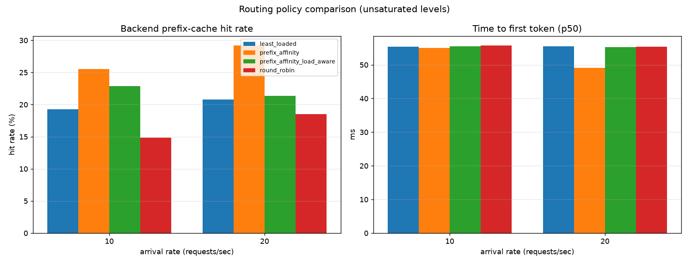
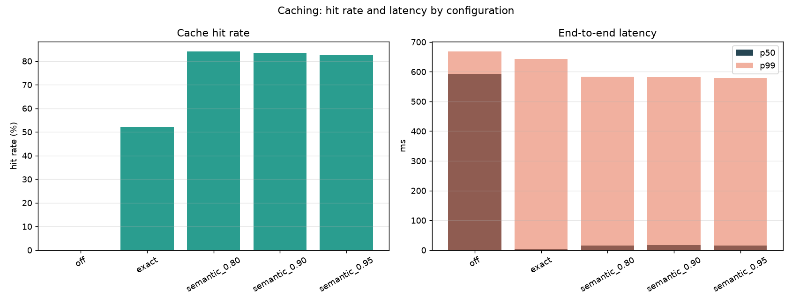
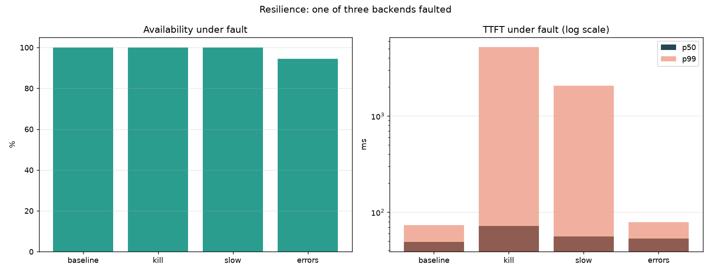

# Waypoint benchmark results

Generated by `bench/report.py` from the JSON files in this directory.
Every number here was produced by `bench/run.sh`; nothing is hand-entered.
Re-run with `make bench-routing` (etc.) and regenerate with `make bench-report`.

## Routing policies

All four policies under identical load, with KV cache capacity deliberately
scarce relative to the prompt working set. Each cell starts from a cold fleet.

| Policy | RPS | Prefix hit rate | TTFT p50 | TTFT p95 | TTFT p99 | Load imbalance |
|---|---:|---:|---:|---:|---:|---:|
| `round_robin` | 10 | 14.8% | 55.8 ms | 73.3 ms | 74.3 ms | 1.01x |
| `round_robin` | 20 | 18.5% | 55.4 ms | 73.5 ms | 74.8 ms | 1.00x |
| `round_robin` | 40 | 20.3% | 7,922.1 ms | 14,061.5 ms | 14,511.8 ms | 1.00x |
| `least_loaded` | 10 | 19.3% | 55.4 ms | 73.0 ms | 74.2 ms | 1.02x |
| `least_loaded` | 20 | 20.8% | 55.5 ms | 73.3 ms | 74.7 ms | 1.00x |
| `least_loaded` | 40 | 16.8% | 8,109.9 ms | 14,175.2 ms | 14,666.9 ms | 1.00x |
| `prefix_affinity` | 10 | 25.5% | 55.0 ms | 72.9 ms | 73.9 ms | 1.36x |
| `prefix_affinity` | 20 | 29.2% | 49.1 ms | 82.9 ms | 152.4 ms | 1.23x |
| `prefix_affinity` | 40 | 30.0% | 7,811.8 ms | 14,308.9 ms | 19,126.0 ms | 1.10x |
| `prefix_affinity_load_aware` | 10 | 22.9% | 55.5 ms | 73.2 ms | 74.0 ms | 1.20x |
| `prefix_affinity_load_aware` | 20 | 21.4% | 55.2 ms | 73.1 ms | 74.8 ms | 1.17x |
| `prefix_affinity_load_aware` | 40 | 24.2% | 7,691.5 ms | 13,973.8 ms | 18,807.9 ms | 1.10x |

**At 20 RPS** (highest level where the fleet is not saturated): `prefix_affinity` raises backend prefix-cache hit rate from 18.5% to 29.2% (**+57%** relative) and changes p50 TTFT by **-11%** (55.4 ms → 49.1 ms), at the cost of load imbalance rising from 1.00x to 1.23x.

> Levels 40 RPS saturate this fleet (p50 TTFT in seconds). Those rows measure queueing behavior under overload, not routing quality, and should not be read as a policy comparison.

## Caching

Workload: 30% verbatim repeats, 25% reworded repeats, `temperature=0`.
Each configuration runs against a cold cache.

| Configuration | Threshold | Hit rate | E2E p50 | E2E p95 | E2E p99 |
|---|---:|---:|---:|---:|---:|
| `off` | — | 0.0% | 592.0 ms | 641.2 ms | 668.1 ms |
| `exact` | — | 52.2% | 4.0 ms | 609.0 ms | 642.9 ms |
| `semantic_0.80` | 0.80 | 84.1% | 16.0 ms | 566.6 ms | 583.2 ms |
| `semantic_0.90` | 0.90 | 83.5% | 17.0 ms | 564.6 ms | 581.0 ms |
| `semantic_0.95` | 0.95 | 82.4% | 16.0 ms | 565.3 ms | 579.1 ms |

**Exact cache** at a 52.2% hit rate cuts p50 end-to-end latency from 592.0 ms to 4.0 ms (**148x** at the median). p95 and p99 barely move, which is expected: the tail is made of cache *misses*, which still pay full generation cost.

**Semantic cache** raises the hit rate from 52.2% (exact only) to 84.1% at threshold 0.80, by serving the reworded 25% that exact matching cannot.

> **Measured caveat on thresholds.** Hit rate is roughly flat across thresholds 0.80–0.95 because `all-MiniLM-L6-v2` scores this workload's rewordings above 0.95 — the threshold only begins to bind below the similarity of a genuine paraphrase. Repeated runs of the 0.80 configuration also varied between 52% and 84% hit rate, so the threshold column should be read as *no measurable difference in this range* rather than as a fine-grained curve. A sharper experiment needs adversarial near-misses, not just paraphrases.

## Resilience

One of three backends is faulted for the duration of each run. `kill` makes it accept connections and never respond (so the TTFT deadline, not a connection error, is what detects it); `slow` adds 2s of latency; `errors` returns HTTP 500 for 30% of requests.

| Scenario | Availability | TTFT p50 | TTFT p99 | Upstream errors | Shed (503) |
|---|---:|---:|---:|---:|---:|
| `baseline` | 100.0% | 49.1 ms | 73.6 ms | 0 | 0 |
| `kill` | 100.0% | 72.2 ms | 5,210.8 ms | 0 | 0 |
| `slow` | 100.0% | 55.9 ms | 2,072.0 ms | 0 | 0 |
| `errors` | 94.5% | 53.3 ms | 78.8 ms | 22 | 0 |

**A dead backend costs no availability.** With one of three backends hung, availability stays at 100.0%: requests that hit it fail their TTFT deadline and are retried on a healthy peer. The cost is tail latency — p99 rises from 73.6 ms to 5,210.8 ms, bounded by the 5s TTFT deadline plus the retry.

**The retry budget is visible here.** Under a 30% error rate on one backend, availability is 94.5% rather than 100%. That is the retry budget working as designed, not a defect: roughly 10% of all traffic fails its first attempt, which is exactly the configured 10% retry budget, so some requests find no budget left and fail rather than amplifying load on a struggling fleet.

**No circuit breaker tripped in these runs, and that is correct.** Hung requests inflate a backend's in-flight token count, so the load-aware routing policy steers traffic away from it faster than the breaker can accumulate the samples it needs to trip — the load signal moves before the error signal does. Breaker trip and recovery are measured directly in the Toxiproxy integration suite (`test/integration/resilience_test.go`), where a backend whose connections are severed fails *fast*, accumulates samples quickly, and trips after 13 requests, recovering 2.56s later.

## Horizontal scaling and gateway overhead

### What the gateway costs

Identical workload, one backend, all gateway features disabled, measured below saturation so the delta is the proxy hop rather than queueing.

| Path | p50 | p95 | p99 |
|---|---:|---:|---:|
| Direct to backend | 386.0 ms | 405.0 ms | 413.0 ms |
| Through Waypoint | 387.5 ms | 404.0 ms | 407.0 ms |
| **Added** | **1.50 ms** | -1.00 ms | -5.99 ms |

The gateway adds **1.5 ms at p50**. The p95/p99 deltas are negative here, which does not mean the proxy makes requests faster — it means the added cost is smaller than run-to-run variation at the tail, so the honest claim is that overhead is within noise of the backend's own variance.

### Rate limits hold across replicas

The same tenant's traffic is spread across every replica. A per-process limiter would admit roughly N times the configured rate at N replicas.

| Replicas | Configured RPM | Requests sent | Allowed | Rate limited |
|---:|---:|---:|---:|---:|
| 1 | 300 | 1,000 | 424 | 576 |
| 2 | 300 | 1,000 | 424 | 576 |
| 4 | 300 | 1,001 | 424 | 577 |

Allowed requests vary by **0** across 1, 2 and 4 replicas — the limit is genuinely global, enforced by an atomic Redis Lua script rather than per-process counters.

> Throughput does not rise with replica count because the *backends* are the bottleneck, not the gateway. Adding gateway replicas adds request-handling capacity and availability, not inference capacity.

## Charts

---

Environment and workload shape

| Field | Value |
|---|---|
| OS | macOS-26.6.2-arm64-arm-64bit-Mach-O |
| CPU | Apple M3 (8 cores) |
| Go | go version go1.27.2 darwin/arm64 |
| k6 | k6 v2.3.0 (commit/devel, go1.27.1, darwin/arm64) |
| Git SHA | `abaf918` (dirty) |
| Generated | 2026-10-13T11:18:34.537410+00:00 |
| Run duration | 30s |
| Backends | 3 |
| Distinct system prompts | 16 |
| KV cache blocks per backend | 24 |
| Routing prefix tokens | 128 |

> KV cache capacity is deliberately scarce relative to the prompt working set; with abundant capacity every backend holds every prefix and routing policy cannot matter.

